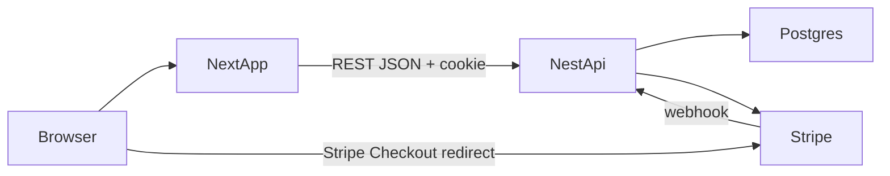

# gg-ecommerce

A gaming-gear store for a portfolio: keyboards, mice, and headsets, with a working catalog, cart, and Stripe Checkout.

Next.js serves the storefront. NestJS owns the catalog, cart, stock, orders, and payments. PostgreSQL stores the data. Prices are integer cents.

## What it shows

- **Catalog.** Public product list with category filters, detail pages, and live stock from the API.
- **Accounts.** Register and login with bcrypt password hashes. The session is an httpOnly, `SameSite=Lax` JWT cookie. Admin routes require the `ADMIN` role.
- **Cart and orders.** Each user has one cart. After payment, the account page lists that user's orders.
- **Admin.** Create, edit, and delete products, and list every order.
- **Checkout and stock.** Starting checkout reserves stock inside a database transaction with compare-and-swap, then opens a Stripe Checkout session. The cart is cleared only after `checkout.session.completed`. If session creation fails or the session expires, the order becomes `FAILED` and the reserved stock returns.
- **Shared contracts.** [`packages/shared`](packages/shared/src/index.ts) holds the TypeScript types, Zod schemas for login, register, and product forms, and `formatPrice`. The API checks incoming bodies with class-validator DTOs that follow the same rules.
- **Tests.** Vitest covers cart, checkout, and orders. Playwright runs a browser purchase against Stripe's test card. GitHub Actions lints the API and the web app and runs the API unit tests.

## Stack

- pnpm workspace: `apps/web`, `apps/api`, `packages/shared`
- Next.js 16, React 19, React Compiler, Tailwind CSS 4
- NestJS 12, Passport JWT, class-validator
- Prisma Next (`@prisma/orm-postgres` 8 RC) and PostgreSQL 16 in Docker
- Stripe Checkout and signed webhooks
- Zod, Vitest, Playwright, oxlint

## Architecture



Stock is reserved when the Checkout session is created and released if that creation fails or the session expires. Payment is confirmed only by the `checkout.session.completed` webhook.

## Run it

Node 24 or newer, pnpm 10, and Docker.

```bash
pnpm install
```

Copy the API variables from `.env.example` into `apps/api/.env`, and put `NEXT_PUBLIC_API_URL` in `apps/web/.env.local`.

```bash
pnpm db:up
pnpm db:init
pnpm db:seed
pnpm dev
```

The store is at http://localhost:3000 and the API at http://localhost:4000.

After the first `pnpm db:init`, schema changes are applied from `apps/api` with `pnpm prisma db update`. `pnpm prisma contract emit` refreshes the generated contract when `contract.prisma` changes.

The seed admin is `admin@gg.local` / `admin12345`.

## Stripe test payment

1. Put a test secret key in `apps/api/.env` as `STRIPE_SECRET_KEY`.
2. In another terminal, run `pnpm stripe:listen` and copy the `whsec_...` secret into `STRIPE_WEBHOOK_SECRET`. Restart the API after changing it.
3. Log in, add a product, and open the cart.
4. Checkout, then pay on Stripe with `4242 4242 4242 4242`, any future expiry, and any CVC.
5. The browser lands on `/checkout/success`. The `checkout.session.completed` webhook marks the order `PAID`, keeps the reserved stock, and clears the cart. If the session expires, the order becomes `FAILED` and the stock comes back.

## Tests

```bash
pnpm --filter api test
pnpm test:e2e
```

`pnpm test:e2e` is the browser purchase. It needs `pnpm dev`, a seeded database, and the Stripe test key. Install the browser once with `pnpm exec playwright install chromium`.

GitHub Actions runs API lint, web lint, and the API unit tests on every push and pull request.
