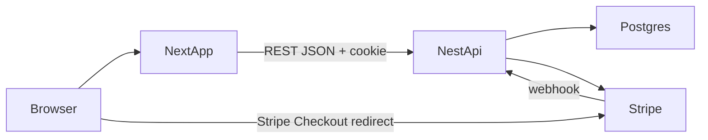

# gg-ecommerce

A small gaming-gear store: keyboards, mice, and headsets. Next.js serves the pages. NestJS owns the catalog, cart, stock, orders, and Stripe. PostgreSQL stores the data.



Money is integer cents. Stock is reserved when checkout starts and released if the Stripe session expires or session creation fails. The webhook, not the success page, marks an order paid.

## Run it

Node 24 or newer, pnpm 10, and Docker.

```bash
pnpm install
```

Put the API variables from `.env.example` in `apps/api/.env`, and `NEXT_PUBLIC_API_URL` in `apps/web/.env.local`.

```bash
pnpm db:up
pnpm db:init
pnpm db:seed
pnpm dev
```

The store is at http://localhost:3000 and the API at http://localhost:4000.

After the first `pnpm db:init`, schema changes are applied from `apps/api` with `pnpm prisma db update`. `pnpm prisma contract emit` refreshes the generated contract when `contract.prisma` changes.

The seed admin is `admin@gg.local` / `admin12345`.

## Stripe test payment

1. Put a test secret key in `apps/api/.env` as `STRIPE_SECRET_KEY`.
2. In another terminal, run `pnpm stripe:listen` and copy the `whsec_...` secret into `STRIPE_WEBHOOK_SECRET`. Restart the API after changing it.
3. Log in, add a product, and open the cart.
4. Checkout, then pay on Stripe with `4242 4242 4242 4242`, any future expiry, and any CVC.
5. The browser lands on `/checkout/success`. The order becomes `PAID`, stock stays down, and the cart is cleared only after the `checkout.session.completed` webhook. If the session expires, the order becomes `FAILED` and the stock comes back.

## Tests

```bash
pnpm --filter api test
pnpm test:e2e
```

`pnpm test:e2e` is the browser purchase. It needs `pnpm dev`, a seeded database, and the Stripe test key. Install the browser once with `pnpm exec playwright install chromium`.

GitHub Actions runs API lint, web lint, and the API unit tests on push.
